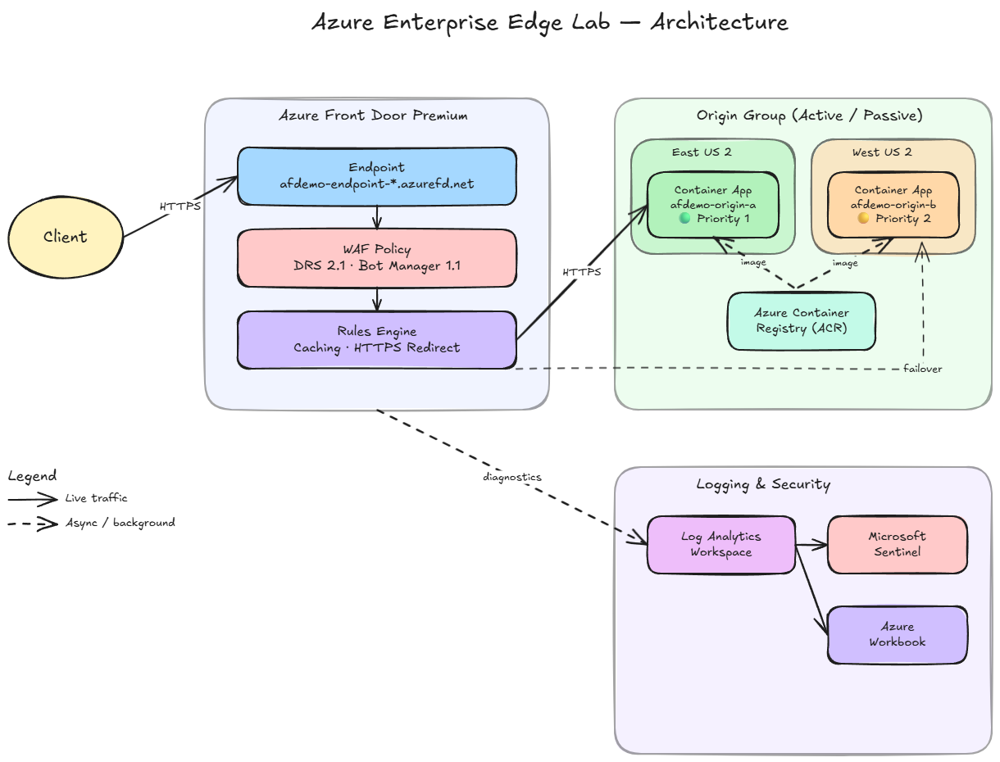
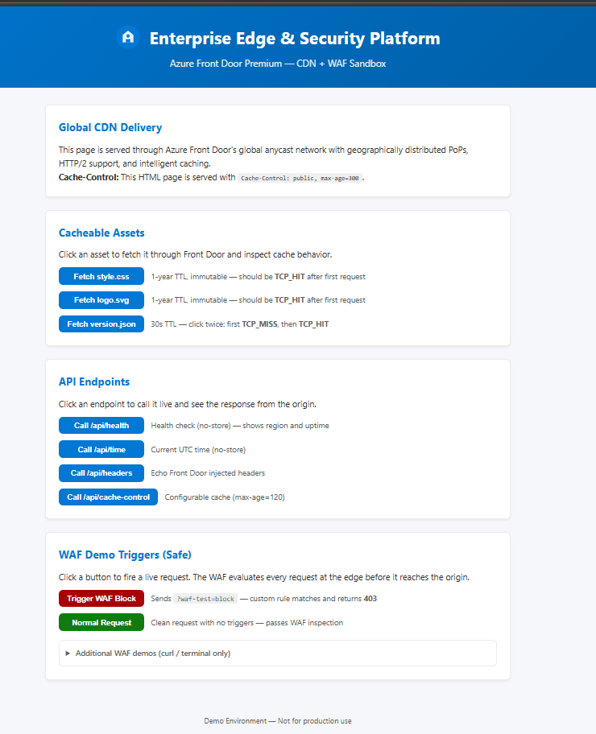

# Azure Enterprise Edge Lab

> End-to-end Azure edge security lab — Front Door Premium with WAF, dual-region Container Apps failover, Microsoft Sentinel, SOC automation, and Azure Workbooks. One-click deploy with Bicep + Azure Developer CLI (azd).

---

## Architecture Overview



Explore the [interactive architecture diagram](https://matthansen0.github.io/azure-enterprise-edge-lab/).

See [docs/architecture.md](docs/architecture.md) for component details, caching strategy, WAF rules, and more.

## Prerequisites

Open this repo in the provided **Dev Container** — all required tooling (Azure CLI, azd, Bicep, Node.js, Docker, ShellCheck, hey, jq, OpenSSH) is pre-installed.

## Quickstart

### 1. Login (device code)

```bash
azd auth login --use-device-code
az login --use-device-code
```

### 2. Configure (optional)

```bash
# Defaults are set in .devcontainer/devcontainer.json remoteEnv.
# Override as needed:
export DEMO_PREFIX="afdemo"          # Resource naming prefix (lowercase, no hyphens)
export DEMO_LOCATION_A="eastus2"     # Primary region
export DEMO_LOCATION_B="westus2"     # Secondary region (failover)

# DEMO_RG is only needed if you deployed without azd. The scripts otherwise
# read AZURE_RESOURCE_GROUP from the active azd environment automatically.
export DEMO_RG="rg-afd-demo"
```

### 3. Deploy

> **Before you enable Security Copilot**: it is **not** deployed by default (it bills at ~\$4/hr per SCU) and its `Microsoft.SecurityCopilot` resource provider is a preview RP that may need registering on your subscription. See [SOC Automation Stub — Security Copilot Integration](docs/soc-automation-stub.md#security-copilot-integration-opt-in) for the full prerequisites and portal walkthrough.
>
> To opt in, set the parameter **before** running `azd up`:
>
> ```bash
> azd env set DEPLOY_SECURITY_COPILOT true
> ```
>
> The `preprovision` hook automatically checks (and registers, if needed) the `Microsoft.SecurityCopilot` provider when this flag is set, and the `postdeploy` hook verifies the capacity was actually created — watch the `azd up` output for a clear pass/fail instead of a silent skip.

```bash
azd init              # First time: select environment name, subscription, location
azd up                # Provisions Bicep infra + builds/deploys app to both origins
```



### 4. Open the Visual Demo

1. Open the Front Door endpoint URL returned by the deployment.
2. In the Azure portal, open the deployed resource group (default: `rg-afd-demo`).
3. Use the website controls to demonstrate caching, APIs, WAF blocking, and the active origin region.
4. Use the portal to show Front Door, WAF, failover, diagnostics, and workbooks.

Follow the [Visual Demo Lab Guide](docs/sandbox-playbook.md) for the complete audience-facing flow. The scripts under `scripts/` remain available for operator automation and troubleshooting, but are not required during the demo.

### 5. Destroy

```bash
azd down              # Deletes all provisioned resources
```

## Sandbox Playbook

See the [Visual Demo Lab Guide](docs/sandbox-playbook.md) for a portal-first walkthrough driven by the live website controls.

## Validation and lab-rot triage

```bash
bash scripts/test.sh       # All API, site, watcher and compiled-IaC regressions + ShellCheck
```

Install API dependencies with `cd apps/api && npm ci` if they are missing.
The full suite also requires Azure CLI/Bicep and ShellCheck (included in the dev container).

For a deployed lab, run the read-only live smoke/regression suite after propagation:

```bash
SMOKE_BASE_URL="https://<front-door-hostname>" \
SMOKE_FRONT_DOOR=true \
SMOKE_ORIGIN_A_URL="https://<origin-a-hostname>" \
SMOKE_ORIGIN_B_URL="https://<origin-b-hostname>" \
node scripts/smoke-test.mjs
```

This checks the site, static TTLs, all API endpoints, credential redaction, query-string
cache isolation, HTTP-to-HTTPS redirects, safe WAF demos (including lowercase transforms),
and an actual edge cache HIT. Both origin URLs are optional but recommended to verify
each region independently. For local application-only smoke tests, omit `SMOKE_FRONT_DOOR`
and use `SMOKE_BASE_URL=http://localhost:8080`.

To test failover, disable origin A using [toggle-failover.sh](scripts/toggle-failover.sh),
wait for propagation, and rerun with `SMOKE_EXPECTED_ORIGIN=b`. Always re-enable A,
then verify recovery with `SMOKE_EXPECTED_ORIGIN=a`. The smoke suite itself does not mutate Azure.

Validate the deployed Sentinel query against Azure's KQL engine (requires `az login`
and workspace query permissions):

```bash
SMOKE_WORKSPACE_ID="<Log Analytics workspace customer ID>" node scripts/test-sentinel-query.mjs
```

This tests the actual query, missing-table/missing-column cold starts, and synthetic
events at the five/six-block threshold, including client/time-bin isolation and allow
events. Synthetic events are query-local; nothing is ingested into the workspace.

The weekly [lab-rot watcher](.github/workflows/lab-rot-watch.yml) is advisory, not a deployment
test. Prioritize broken deployment paths, unsafe configuration and learner-facing failures.
An API's age alone does not establish retirement or justify changing a working deployment;
verify provider support before upgrading. In particular, do not downgrade
`diagnosticSettings@2021-05-01-preview` to an older GA API merely to quiet the age linter.
Keep age warnings visible for review.

Reports are deduplicated by finding identity (file, resource type and API version), not
changing age counts, runner paths, source positions or the latest suggested versions.
An unchanged report already tracked in an open issue or explicitly closed as **not planned**
does not create another issue or weekly comment. New findings, or a recurrence after a
**completed** fix, still create a report. Close stale/duplicate reports as not planned with
a rationale and retain one actionable tracker when real work remains.

## Documentation Index

| Document | Description |
|----------|-------------|
| [Architecture](docs/architecture.md) | System architecture and component map |
| [Visual Demo Lab Guide](docs/sandbox-playbook.md) | Portal-first walkthrough using the live website controls |
| [Analytics KQL](docs/analytics-kql.md) | KQL queries for dashboards and ad-hoc analysis |
| [Operating Model](docs/operating-model.md) | RACI, support tiers, SLA-backed incident flow |
| [Migration & Onboarding](docs/migration-onboarding.md) | Phased migration, rollback, DNS cutover |
| [TLS / Certificate Mgmt](docs/tls-certificate-management.md) | Managed vs. BYOC certs, rotation |
| [SOC Automation Stub](docs/soc-automation-stub.md) | Sentinel automation / Logic App skeleton |

## Design Principles

- **No real exploit payloads** — WAF blocking is shown with safe custom headers and benign traffic.
- **Fully idempotent** — deploy and destroy cleanly.
- **Self-contained** — everything needed to deploy is in this repo.

## Repo Stats

<p align="center">
  <a href="https://repologbook.com/">
    
  </a>
</p>
